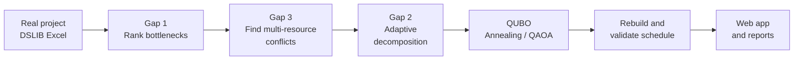
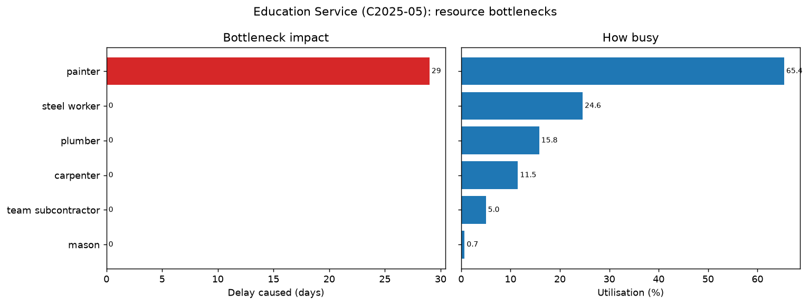
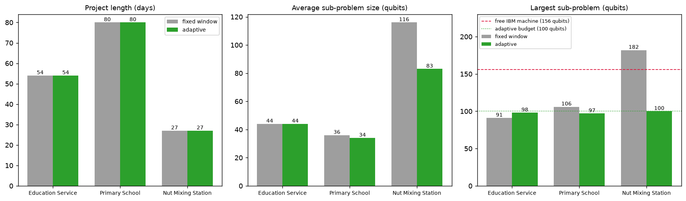
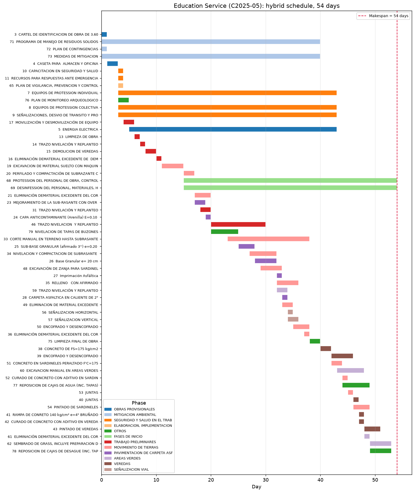
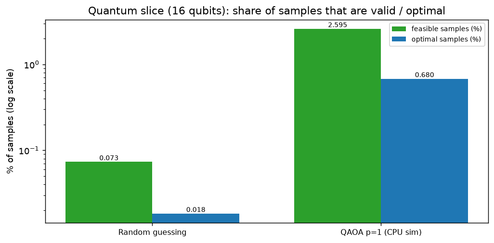

<div align="center">

# ⚛️ Quantum Construction Scheduler

### Hybrid quantum-classical scheduling of **real construction projects**

*Finds the crews that delay a project, isolates the conflicts, and hands quantum-sized pieces to QAOA and quantum annealing*

[](https://quantum-construction-scheduling.streamlit.app/)


**[🚀 Live demo](https://quantum-construction-scheduling.streamlit.app/)** · **[How it works](#-how-it-works)** · **[Results](#-results)** · **[Run it yourself](#-run-it-yourself)**

</div>

---

## 🏗️ The problem

A construction schedule has to respect two kinds of rules at once:

- **Order:** foundations before walls, walls before roof.
- **Crews and machines:** only 3 painters, 1 crane, 1 aerial platform per day.

This is the **Resource-Constrained Project Scheduling Problem (RCPSP)**, which is NP-hard. Written as one quantum optimisation problem (a QUBO), a real 58-activity project needs **2,299 qubits**. That's far beyond what today's quantum devices can run reliably.

**This project makes it fit:** it finds *where* the project is constrained and sends only those pieces to a quantum solver.

---

## ✨ Highlights

| | |
|---|---|
| 📉 **−29 % project length** | *Education Service* (real school project, Peru): **76 → 54 days**, zero rule violations |
| 🎯 **Bottleneck found automatically** | Painters cause **29 days** of delay; one extra painter saves 4 more days, two reach the 47-day critical path |
| ⚛️ **QAOA beats random guessing 35×** | On the 16-qubit quantum core, QAOA samples valid schedules 35 times more often, and finds the optimum |
| 🧩 **Fits real hardware** | Every quantum sub-problem stays ≤ 100 qubits (IBM's free machine has 156) |
| 🌐 **Interactive web app** | Run every stage live in the browser, change crew sizes, compare schedules, light and dark mode |
| ✅ **Verified** | 39 automated tests · 22/22 run-time checks · one shared schedule checker for every method |

---

## 🧠 How it works



| Step | What happens |
|---|---|
| **1 · Read** | Real project files: activities, all four link types (FS/SS/FF/SF with lags), crew and equipment needs |
| **2 · Rank** *(Gap 1)* | For every resource: how many days it delays the project alone, and how many days are saved if it were unlimited |
| **3 · Isolate** *(Gap 3)* | Conflict graph of jobs fighting over the same crews, including jobs blocked by **two resources at once** |
| **4 · Split** *(Gap 2)* | Sub-problems sized to each conflict, then shrunk to fit a qubit budget |
| **5 · Quantum** | Each piece becomes a QUBO, solved by simulated quantum annealing or QAOA (Qiskit) |
| **6 · Rebuild** | Only valid, shorter schedules are kept, checked against every rule |

<details>
<summary><b>📐 The QUBO formulation</b> (click to expand)</summary>

Binary variable $x_{j,s}=1$ if activity $j$ starts on day $s$:

$$
E=\sum_t (t-t_{\min})\,e_t + P\Big[\sum_j\big(\textstyle\sum_s x_{j,s}-1\big)^2
+\sum_{i\to j}\sum_{s'<s+\delta_{ij}}x_{i,s}x_{j,s'}
+\sum_{k,t}\big(\text{use}_{k,t}+z_{k,t}-R_k\big)^2\Big]
$$

- **Objective:** finish as early as possible.
- **Penalty 1:** every activity starts exactly once.
- **Penalty 2:** precedence links (all link types converted to a start-gap rule).
- **Penalty 3:** daily crew capacity, using binary slack variables $z_{k,t}$.

The penalty weight is set just above the objective range, so any rule violation costs more than any possible saving.

</details>

---

## 📊 Results

**Three real projects** from DSLIB v3.4 (Ghent University):

| Project | Activities | Top bottleneck | Initial plan | **Hybrid** | Largest sub-problem |
|---|---:|---|---:|---:|---:|
| Education Service (Peru) | 58 | painters (29 days) | 76 days | **54 days (−29 %)** | 98 qubits |
| Primary School (Peru) | 52 | plumbers (20 days) | 80 days | 80 days | 97 qubits |
| Nut Mixing Station (Belgium) | 58 | aerial platform + labourers | 27 days | 27 days | 100 qubits |

*When the starting plan is already tight, the hybrid reports no gain. It never makes a schedule worse.*

<table>
<tr>
<td width="50%"><br><sub><b>Gap 1:</b> which crews delay Education Service, and by how much</sub></td>
<td width="50%"><br><sub><b>Gap 2:</b> adaptive sub-problems stay inside the qubit budget</sub></td>
</tr>
<tr>
<td width="50%"><br><sub><b>Hybrid schedule:</b> Education Service in 54 days</sub></td>
<td width="50%"><br><sub><b>Quantum core:</b> QAOA vs random guessing (log scale)</sub></td>
</tr>
</table>

---

## 🌐 The web app

**👉 [quantum-construction-scheduling.streamlit.app](https://quantum-construction-scheduling.streamlit.app/)**: nothing to install.

| Tab | What you can do |
|---|---|
| **Overview** | Key figures and the six-step pipeline |
| **Bottlenecks** | Interactive ranking of every crew and machine |
| **Conflicts** | Drag and hover the conflict graph; multi-resource jobs are highlighted |
| **Hybrid schedule** | One click → zoomable Gantt chart, daily crew use, CSV download |
| **Quantum core** | The worst conflict as a QUBO heatmap; solve it with annealing or QAOA |
| **Method** | Formulation and research gaps |

**What-if:** change crew sizes in the sidebar and every tab recomputes.

> ⏱️ The free server is CPU-only, so the first QAOA run takes a few minutes. After that it's cached and instant.

---

## 💻 Run it yourself

**Windows (PowerShell, VS Code):**

```powershell
git clone https://github.com/batulhs/Quantum-Construction-Scheduling.git
cd Quantum-Construction-Scheduling
py -m venv .venv
.\.venv\Scripts\activate
py -m pip install -r requirements.txt

py -m streamlit run app.py     # web app  -> http://localhost:8501
py run_demo.py                 # full pipeline, writes results/ (~1 min, ends with 22/22)
py -m pytest -q                # 39 tests
```

<details>
<summary><b>macOS / Linux</b></summary>

```bash
git clone https://github.com/batulhs/Quantum-Construction-Scheduling.git
cd Quantum-Construction-Scheduling
python3 -m venv .venv && source .venv/bin/activate
pip install -r requirements.txt
streamlit run app.py
```

</details>

<details>
<summary><b>Google Colab (GPU): 26-qubit quantum core</b></summary>

Open `colab_gpu.ipynb` in Colab, choose **Runtime → Change runtime type → T4 GPU**, and run the cells top to bottom.
The GPU build of the simulator lets the quantum core grow from 16 to 26 qubits.

</details>

<details>
<summary><b>Real IBM quantum hardware (free Open Plan)</b></summary>

```powershell
py run_ibm.py --fake    # rehearsal on a noisy copy of ibm_kingston, no account needed
py run_ibm.py           # the real 156-qubit machine (needs a free IBM Quantum account)
```

Your API key is saved on your computer, never in this repository.

</details>

---

## 📁 Project structure

```text
Quantum-Construction-Scheduling/
├── app.py                  interactive web app (Streamlit)
├── run_demo.py             full pipeline on all three projects
├── run_ibm.py              optional run on IBM quantum hardware
├── colab_gpu.ipynb         Google Colab GPU notebook
├── requirements.txt        Python packages
├── src/
│   ├── dslib.py            reads the real DSLIB project files
│   ├── project.py          project model; all link types -> start-gap rules
│   ├── bottleneck.py       Gap 1 ranking, Gap 3 conflict graph and cores
│   ├── qubo.py             QUBO formulation with penalties and slack bits
│   ├── quantum.py          annealing, QAOA, hybrid with Gap 2 decomposition
│   ├── slice_problem.py    automatic quantum core extraction
│   ├── classical.py        priority-rule heuristic, CP-SAT (verification)
│   ├── evaluate.py         one schedule checker and metrics for every method
│   ├── visualize.py        charts
│   └── ui_jobs.py          runs QAOA for the web app in its own process
├── data/dslib/             the three real project files
├── results/                charts and CSVs from run_demo.py
└── tests/                  39 automated tests
```

---

## 🛠️ Built with

**Quantum:** Qiskit · Qiskit Aer · qiskit-ibm-runtime · dimod / dwave-samplers
**Classical:** Google OR-Tools (CP-SAT) · NumPy · pandas · NetworkX
**Interface:** Streamlit · Plotly · Matplotlib
**Testing:** pytest

---

## 📚 Data and references

- **Data:** J. Batselier and M. Vanhoucke, "Construction and evaluation framework for a real-life project database," *International Journal of Project Management*, 33(3), 697–710, 2015. DSLIB v3.4, OR&S group, Ghent University.
- **Formulation:** A. A. B. Pritsker, L. J. Watters and P. M. Wolfe, "Multiproject scheduling with limited resources: a zero-one programming approach," *Management Science*, 16(1), 1969.
- **Resource strength:** R. Kolisch, A. Sprecher and A. Drexl, "Characterization and generation of a general class of resource-constrained project scheduling problems," *Management Science*, 41(10), 1995.

---

<div align="center">

**Hybrid quantum-classical optimisation for construction scheduling**

*If this project was useful to you, consider giving it a ⭐*

</div>
